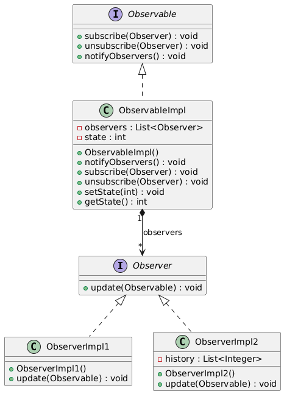
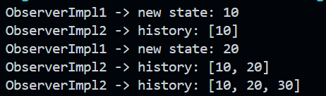

# Rapport de Travaux Pratiques : Design Pattern Observer

**Encadrant :** Mohamed YOUSSFI  
**Étudiant(e) :** Youness HATTABI

---

## Table des Matières

1. [Introduction](#1-introduction)
2. [Présentation du pattern](#2-présentation-du-pattern)
   - 2.1 [Problème posé](#21-problème-posé)
   - 2.2 [Solution proposée](#22-solution-proposée)
   - 2.3 [Acteurs du pattern](#23-acteurs-du-pattern)
3. [Diagramme de classes](#3-diagramme-de-classes)
4. [Implémentation](#4-implémentation)
   - 4.1 [L'interface `Observer`](#41-linterface-observer)
   - 4.2 [L'interface `Observable`](#42-linterface-observable)
   - 4.3 [La classe `ObservableImpl`](#43-la-classe-observableimpl)
   - 4.4 [La classe `ObserverImpl1`](#44-la-classe-observerimpl1)
   - 4.5 [La classe `ObserverImpl2`](#45-la-classe-observerimpl2)
5. [Tests et Résultats](#5-tests-et-résultats)
6. [Conclusion](#6-conclusion)

---

## 1. Introduction

Le pattern **Observer** fait partie des patterns de conception dits _comportementaux_. Il définit une dépendance de type **un-à-plusieurs** entre objets : lorsqu'un objet change d'état, tous les objets qui dépendent de lui sont notifiés et mis à jour automatiquement.

Ce rapport présente l'implémentation en Java de ce pattern à partir d'un diagramme de classes UML. Le projet est organisé comme un projet Maven, avec le package `obs` pour le pattern et le package `hattabi.youness` pour la classe de test.

---

## 2. Présentation du pattern

### 2.1 Problème posé

Dans de nombreuses applications, plusieurs composants doivent réagir au changement d'état d'un autre composant (interface graphique, système d'événements, tableaux de bord, etc.). Faire en sorte que l'objet observé connaisse directement tous les objets intéressés créerait un **couplage fort** et rendrait l'ajout ou la suppression d'un intéressé coûteux.

### 2.2 Solution proposée

Le pattern Observer introduit deux abstractions :

- l'**observable** (ou sujet), qui conserve la liste de ses observateurs et les notifie à chaque changement d'état ;
- l'**observateur**, qui expose une méthode `update` appelée par l'observable.

L'observable ne connaît ses observateurs qu'à travers l'interface `Observer`. Il est donc possible d'ajouter ou de retirer des observateurs à l'exécution, sans modifier l'observable.

### 2.3 Acteurs du pattern

| Rôle                      | Classe / Interface               | Responsabilité                                                           |
| ------------------------- | -------------------------------- | ------------------------------------------------------------------------ |
| Sujet (abstraction)       | `Observable`                     | Déclare `subscribe`, `unsubscribe` et `notifyObservers`                  |
| Sujet concret             | `ObservableImpl`                 | Stocke l'état et la liste des observateurs, notifie lors d'un changement |
| Observateur (abstraction) | `Observer`                       | Déclare la méthode `update`                                              |
| Observateurs concrets     | `ObserverImpl1`, `ObserverImpl2` | Réagissent à la notification                                             |

---

## 3. Diagramme de classes

**Diagramme UML :**



Lecture du diagramme :

- `ObservableImpl` **implémente** `Observable` (flèche pointillée).
- `ObservableImpl` **contient** une liste d'`Observer` (association avec losange, attribut `observers`).
- `ObserverImpl1` et `ObserverImpl2` **implémentent** `Observer`.
- `ObserverImpl2` possède en plus un attribut `history` qui conserve les états reçus.

**Organisation du projet :**

```
patt-observer/
├── pom.xml
└── src/main/java/
    ├── hattabi/youness/Main.java
    └── obs/
        ├── Observable.java
        ├── Observer.java
        ├── ObservableImpl.java
        ├── ObserverImpl1.java
        └── ObserverImpl2.java
```

---

## 4. Implémentation

### 4.1 L'interface `Observer`

L'interface `Observer` définit le contrat que doit respecter tout objet souhaitant être notifié. Elle reçoit l'observable en paramètre afin de pouvoir consulter son état.

```java
package obs;

public interface Observer {
    void update(Observable observable);
}
```

---

### 4.2 L'interface `Observable`

L'interface `Observable` définit les trois opérations de gestion des abonnements et de notification.

```java
package obs;

public interface Observable {
    void subscribe(Observer observer);
    void unsubscribe(Observer observer);
    void notifyObservers();
}
```

---

### 4.3 La classe `ObservableImpl`

Cette classe concrète stocke un état entier (`state`) et la liste des observateurs. À chaque appel de `setState`, elle notifie automatiquement tous les abonnés.

```java
package obs;

import java.util.ArrayList;
import java.util.List;

public class ObservableImpl implements Observable {
    private List<Observer> observers = new ArrayList<>();
    private int state;

    public ObservableImpl() {
    }

    @Override
    public void subscribe(Observer observer) {
        observers.add(observer);
    }

    @Override
    public void unsubscribe(Observer observer) {
        observers.remove(observer);
    }

    @Override
    public void notifyObservers() {
        for (Observer observer : observers) {
            observer.update(this);
        }
    }

    public void setState(int state) {
        this.state = state;
        notifyObservers();
    }

    public int getState() {
        return state;
    }
}
```

---

### 4.4 La classe `ObserverImpl1`

Cet observateur affiche simplement le nouvel état à chaque notification.

```java
package obs;

public class ObserverImpl1 implements Observer {
    public ObserverImpl1() {
    }

    @Override
    public void update(Observable observable) {
        ObservableImpl o = (ObservableImpl) observable;
        System.out.println("ObserverImpl1 -> new state: " + o.getState());
    }
}
```

---

### 4.5 La classe `ObserverImpl2`

Cet observateur conserve l'historique de tous les états reçus dans l'attribut `history`.

```java
package obs;

import java.util.ArrayList;
import java.util.List;

public class ObserverImpl2 implements Observer {
    private List<Integer> history = new ArrayList<>();

    public ObserverImpl2() {
    }

    @Override
    public void update(Observable observable) {
        ObservableImpl o = (ObservableImpl) observable;
        history.add(o.getState());
        System.out.println("ObserverImpl2 -> history: " + history);
    }
}
```

---

## 5. Tests et Résultats

```java
package hattabi.youness;

import obs.ObservableImpl;
import obs.ObserverImpl1;
import obs.ObserverImpl2;

public class Main {
    public Main() {
    }

    public static void main(String[] args) {
        ObservableImpl observable = new ObservableImpl();

        ObserverImpl1 o1 = new ObserverImpl1();
        ObserverImpl2 o2 = new ObserverImpl2();

        observable.subscribe(o1);
        observable.subscribe(o2);

        observable.setState(10);
        observable.setState(20);

        observable.unsubscribe(o1);
        observable.setState(30);
    }
}
```

**Sortie attendue :**

```
ObserverImpl1 -> new state: 10
ObserverImpl2 -> history: [10]
ObserverImpl1 -> new state: 20
ObserverImpl2 -> history: [10, 20]
ObserverImpl2 -> history: [10, 20, 30]
```

**Capture de l'exécution :**



Analyse : après le désabonnement de `o1`, seul `o2` réagit au changement d'état à `30`.

---

## 6. Conclusion

Ce travail a permis d'implémenter le pattern Observer. Il montre comment un objet peut diffuser ses changements d'état à plusieurs destinataires tout en restant indépendant de leur implémentation concrète.
